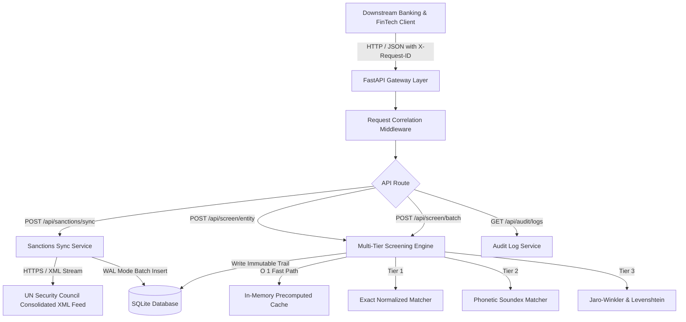

# Architecture: AML Sanctions Screening Gateway

## System Overview
The **AML Sanctions Screening Gateway** is a production-grade Anti-Money Laundering (AML) and Know Your Customer (KYC) screening microservice. It continuously synchronizes with the United Nations Security Council Consolidated Sanctions XML feed, indexes all sanctioned individuals and corporate entities, and delivers sub-20ms multi-tier name resolution across exact, phonetic, and fuzzy distance algorithms.

## Multi-Tier Matching Architecture

### 1. Preprocessing & Normalization
Incoming names and indexed entity aliases undergo NFKD unicode decomposition, accent and diacritic stripping, case folding, and non-alphanumeric punctuation removal.

### 2. Tier 1: Exact Normalized Match & Token Permutation
- Exact normalized string match returns a confidence score of `1.0`.
- Token permutation matching (e.g., `Badege Eric` vs `Eric Badege`) returns `0.98`.

### 3. Tier 2: Phonetic Soundex Match
- Computes American Soundex codes across all whitespace-delimited tokens.
- Phonetic homophones (e.g. `Robert` vs `Rupert`, `Mohammed` vs `Muhamad`) match with `score >= 0.90` guarded by a Jaro-Winkler threshold of `0.70` to prevent cross-category phonetic collisions.

### 4. Tier 3: Fuzzy Metric Fusion (Jaro-Winkler & Levenshtein)
- For non-phonetic orthographic variations (e.g. `Wladimir Putin` vs `Vladimir Putin`), computes Jaro-Winkler similarity with a prefix bonus.
- Length discrepancy filter guards against false-positive prefix matching on short single-token aliases.

## Persistence & Audit Trail
- **SQLite with WAL Mode**: Configured with `PRAGMA journal_mode=WAL;` and `PRAGMA synchronous=NORMAL;` ensuring durable concurrent writes.
- **Immutable Audit Logging**: Every query (single or batch) generates an immutable audit record containing request correlation ID, timestamp, query string, match flag, rule name, score, and matched entity identifier.
